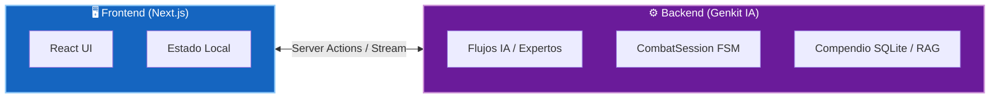
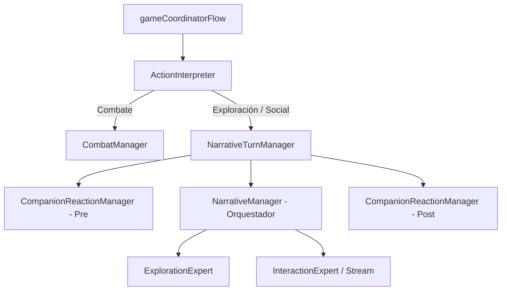

# Arquitectura Técnica Consolidada - D&D Adventures AI

Este documento unifica y simplifica toda la arquitectura del sistema, incluyendo el frontend, el backend de IA, la máquina de estados de combate y los flujos de datos.

---

## 🖥️ Modelo Cliente-Servidor y Estado del Juego

El proyecto sigue un modelo **Stateless** en el backend. Todo el estado necesario para procesar una acción se envía desde el cliente en cada petición a través de **Server Actions** de Next.js.

### Arquitectura Híbrida (Request/Response + Streaming)
- **Modo Clásico:** Para acciones simples de combate o menús, se usa un ciclo Request -> Response estándar.
- **Modo Streaming (Reactivo):** Para diálogos e interacción social, se usa una conexión persistente (SSE) a través de `useGameStream` e `InteractionExpertStream`. El texto se muestra letra a letra, y eventos lógicos (como emboscadas detectadas en mitad del stream) pueden interrumpir la narración y forzar la transición a combate inmediatamente.

---

## 🧠 Estructura del Backend y Flujos de IA

El orquestador lógico del backend es `GameCoordinator`. Su flujo principal delega las responsabilidades en gestores especializados:

### Componentes Clave:
1. **`ActionInterpreter`:** Evalúa semánticamente la intención del jugador (detecta ataques, sigilo, movimiento, o diálogos).
2. **`NarrativeTurnManager`:** Coordina la exploración y las conversaciones sociales, además de calcular los efectos activos (ej. conjuros como `speak_with_animals` que modifican si el grupo puede entenderse con bestias).
3. **`CompanionReactionManager`:** Genera las reacciones de los compañeros del grupo (antes y después de la narración del DM).
4. **`ExplorationExpert`:** Diseñado con conciencia espacial. Administra la niebla de guerra (`visited`, `seen`, `unknown`), realiza pruebas de percepción pasiva automáticas y describe ubicaciones.
5. **`InteractionExpert` / `InteractionExpertStream`:** Resuelve conversaciones y tiradas de diplomacia o engaño con NPCs.

### Arquitectura Neuro-Simbólica de 3 Capas (Robustez)

Para desacoplar por completo la lógica matemática y física del juego de la narración creativa, el backend implementa un patrón neuro-simbólico dividido en tres capas operativas consecutivas:

1. **Capa 1: IA Árbitro (Semántica)**
   - **Componente:** `ActionInterpreter` ([action-interpreter.ts](file:///t:/ProyectosPersonales/Programacion/DnD-Adventures-AI/src/ai/flows/action-interpreter.ts))
   - **Función:** Toma la acción del jugador en lenguaje natural y la traduce a una intención de acción estructurada bajo un esquema Zod.
2. **Capa 2: Motor TypeScript (Simbólica / Determinista)**
   - **Componente:** `GameRulesEngine` ([rules-engine.ts](file:///t:/ProyectosPersonales/Programacion/DnD-Adventures-AI/src/lib/game/rules/rules-engine.ts)) y `EventDispatcher` ([event-dispatcher.ts](file:///t:/ProyectosPersonales/Programacion/DnD-Adventures-AI/src/lib/game/events/event-dispatcher.ts))
   - **Función:** Valida y ejecuta la acción mecánicamente en TypeScript (tiradas de dados reales, comprobación de inventario/llaves, control de estados de contenedores, y transiciones). Genera un conjunto de **Hechos Absolutos del Turno** (`eventsLog`) y actualiza el `worldState`.
3. **Capa 3: IA Narradora (Estética / DM)**
   - **Componente:** `NarrativeManager` ([narrative-manager.ts](file:///t:/ProyectosPersonales/Programacion/DnD-Adventures-AI/src/ai/flows/narrative-manager.ts)) y su prompt central `narrativeDirectorPrompt`
   - **Función:** Recibe los Hechos Absolutos calculados por la Capa 2 y los viste con prosa inmersiva, literaria y adaptada a D&D en español de España. Al DM se le prohíbe estrictamente decidir la resolución de las acciones; se limita a narrar el resultado determinista.

---

## ⚔️ Máquina de Estados Finita (FSM) de Combate

El sistema de combate está modelado mediante una **Máquina de Estados Finita (FSM)** explícita encapsulada en la clase `CombatSession` (patrón State Object). Esto elimina las desincronizaciones de turnos entre cliente y servidor.

### Fases de la FSM de Combate:
1. **`SETUP`:** Inicialización de iniciativa, orden de turnos y aplicación de sorpresa.
2. **`TURN_START`:** Preparación mecánica del turno del combatiente activo.
3. **`WAITING_FOR_ACTION`:** Bloquea el flujo esperando el input del jugador si es su turno.
4. **`PROCESSING_ACTION`:** Ejecución de la acción y cálculo de dados.
5. **`ACTION_RESOLVED`:** Muestra el resultado de la acción y el daño aplicado. Requiere confirmación manual del jugador ("Continuar") antes de cambiar de fase.
6. **`TURN_END`:** Cierre del turno y actualización de efectos temporales.
7. **`COMBAT_END`:** Cierre del encuentro (emite la tirada sintética con `outcome: 'victory'`).

### Componentes de Combate:
- **`CombatInitializer`:** Carga los stats autoritativos del JSON de la aventura ( AC, HP) y calcula las iniciativas iniciales.
- **`TurnProcessor`:** Procesa el turno activo de forma unificada (tanto IA como Jugador).
- **`CombatActionExecutor`:** Resuelve las acciones usando el motor de reglas matemático, determinando impactos de forma determinista (20 es crítico natural, 1 es pifia).
- **`Tacticians` (`EnemyTactician` / `CompanionTactician`):** Deciden qué objetivo atacar y qué habilidad usar (solo lógica táctica, delegando la narración al experto).

---

## 💾 Persistencia del Mundo: Arquitectura "Base State + Deltas"

Para evitar que los enemigos derrotados "resuciten" o las puertas abiertas vuelvan a cerrarse al guardar y cargar la partida, se usa el patrón `WorldState`:

- **Aventura Base (JSON):** Contiene el mapa estático, enemigos por defecto e interactuables.
- **Deltas de Estado (`WorldState`):** Un objeto dinámico guardado en la partida que registra diferencias:
  - `enemiesByLocation`: Registra los enemigos muertos o con HP modificado por sala.
  - `openDoors`: Registra las puertas que ya se han abierto de forma bidireccional.
  - `Fog of War`: Estados de exploración de las habitaciones.

Al renderizar o enviar datos a la IA, el sistema realiza una **mezcla en caliente** entre la aventura base y los deltas, garantizando coherencia absoluta.

---

## 🔌 Inyección de Dependencias (DI)

Para maximizar la testabilidad unitaria y de integración sin depender de llamadas reales a la API de Gemini o Eleven Labs en los tests, se implementa un patrón de inyección de dependencias sencillo en los flujos principales.

Las herramientas de backend y managers aceptan proveedores de servicios (`providers`) opcionales en sus constructores o llamadas. En entornos de test, estos proveedores inyectan mocks predecibles de dados y respuestas de IA.

---

## 📝 Guía y Estructura de Logging

El sistema cuenta con un formateador estructurado que homogeniza los logs de consola tanto en el servidor como en el cliente.

### Formato Estándar:
`[TIMESTAMP] [LEVEL] [ModuleName] Message - key=value key2=value2`

**Niveles de logs recomendados:**
- **`INFO`:** Cambios de estado importantes (inicio de combate, transición de salas, guardado).
- **`WARN`:** Fallos menores recuperables (timeouts de APIs con reintento exitoso, fallos en TTS).
- **`ERROR`:** Excepciones críticas (fallos de conexión a base de datos local, error fatal de API key).
